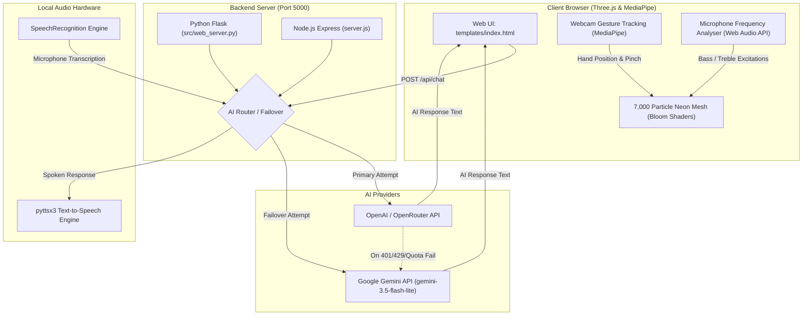

# 🎙️ AI Voice Assistant — Ultra-Bright 3D Neon Core

[](https://www.python.org/)
[](https://nodejs.org/)
[](https://threejs.org/)
[](https://flask.palletsprojects.com/)
[](https://expressjs.com/)
[](LICENSE)

An interactive, multi-modal AI Voice Assistant powered by **Three.js**, **MediaPipe**, **Google Gemini**, and **OpenAI / OpenRouter**. Features a real-time reactive 3D neon particle swarm, webcam gesture control, audio reactivity, continuous speech recognition, and offline text-to-speech.

---

## 📑 Table of Contents

- [Overview](#-overview)
- [Architecture](#-architecture)
- [Key Features](#-key-features)
- [Project Structure](#-project-structure)
- [Prerequisites](#-prerequisites)
- [Installation](#-installation)
- [Configuration](#-configuration)
- [Running the Assistant](#-running-the-assistant)
  - [1. Web Mode (Recommended)](#1-web-mode-recommended)
  - [2. CLI Text Mode](#2-cli-text-mode)
  - [3. CLI Voice Mode](#3-cli-voice-mode)
  - [4. Node.js Server Mode](#4-nodejs-server-mode)
- [Web Interface Controls](#-web-interface-controls)
- [Customization](#-customization)
- [API Reference](#-api-reference)
- [Testing & Diagnostics](#-testing--diagnostics)
- [Troubleshooting](#-troubleshooting)
- [License](#-license)

---

## 🌌 Overview

The **AI Voice Assistant** bridges real-time computer vision and audio processing with large language models. The system responds to spoken or typed questions through natural voice synthesis while dynamically transforming an interactive 7,000-particle 3D neon core.

The backend is built with dual-stack flexibility:
1. **Python Engine**: Python 3 orchestrator with Flask, `pyttsx3`, `SpeechRecognition`, and multi-provider AI failover.
2. **Node.js Engine**: Express.js server alternative with native fetch-based Gemini and OpenRouter integration.

---

## 🏛️ Architecture



---

## ✨ Key Features

- **🎨 7,000 Neon Particle Visualizer**:
  - Accelerated with Three.js `UnrealBloomPass` for high-intensity glow and neon trails.
  - Six procedural particle geometries: **Sphere**, **Heart**, **Helix**, **Torus**, **Ring**, and **Cloud**.
- **🖐️ Real-Time Hand Tracking**:
  - Leverages MediaPipe Hands via the webcam.
  - Horizontal hand translation controls 3D rotation; pinch gestures compress and implode the particle cloud.
- **🎵 Real-Time Audio Reactivity**:
  - Audio spectrum analysis (Web Audio API) drives particle velocity and beat expansion based on frequency bands (bass/treble).
- **🛡️ Multi-Provider AI Failover**:
  - Primary provider: OpenAI / OpenRouter (`gpt-3.5-turbo`).
  - Automatic fallback: Google Gemini (`gemini-3.5-flash-lite`, `gemini-3.5-flash`, `gemini-2.5-flash`).
  - Native support for both legacy `AIza...` API keys and modern Google Auth `AQ...` keys using REST transport (`x-goog-api-key`).
- **🗣️ Offline Text-to-Speech & Speech Recognition**:
  - Zero-latency local TTS synthesis via `pyttsx3` (works without external cloud billing for audio).
  - Voice recognition using Google Speech Recognition backend.
- **⚡ 1-Click Launchers**:
  - Dedicated Windows batch scripts that auto-detect project virtual environments.

---

## 📁 Project Structure

```
par_4.0/
├── src/
│   ├── assistant.py          # Central CLI entry point (voice, text, and web modes)
│   ├── ai_processor.py       # Multi-model AI engine (OpenAI, OpenRouter, Google Gemini)
│   ├── web_server.py         # Flask web server for the 3D visualization
│   ├── voice_input.py        # Microphone speech recognition module
│   └── voice_output.py       # Offline speech synthesis (TTS) module
├── templates/
│   └── index.html            # 3D Three.js particle visualizer, shaders & chat interface
├── tests/
│   ├── test_api_connection.py# Diagnostics for API keys and voice synthesis
│   ├── test_server.js        # Health check for the chat API endpoint
│   └── test_voice.py         # Audio speech synthesis verification
├── START_WEB.bat             # 1-Click launcher for Web Mode (Auto-detects .venv)
├── RESTART_PYTHON_SERVER.bat # Windows script to restart Flask backend
├── RESTART_SERVER.bat        # Windows script to restart Node.js Express backend
├── server.js                 # Express.js backend alternative
├── package.json              # Node.js dependencies & scripts
├── requirements.txt          # Python dependencies
├── QUICKSTART.md             # Concise quick start instructions
├── README.md                 # Complete project documentation
└── .env                      # API keys and environment configuration
```

---

## 📋 Prerequisites

- **Operating System**: Windows 10/11, macOS, or Linux.
- **Python**: Version `3.8` through `3.12`.
- **Node.js** *(Optional)*: Version `18.0.0+` (only needed if running the Express server).
- **Hardware** *(Optional)*:
  - Microphone for voice input.
  - Webcam for hand tracking.

---

## 📦 Installation

### 1. Clone or Open the Workspace
```bash
cd "c:\Users\faiza\OneDrive\Desktop\Completed\par_4.0"
```

### 2. Set Up Python Environment
Create and activate a virtual environment, then install required packages:

```bash
# Create virtual environment
python -m venv .venv

# Activate on Windows (PowerShell):
.venv\Scripts\Activate.ps1
# Or Windows (Command Prompt):
.venv\Scripts\activate.bat

# Install dependencies
pip install -r requirements.txt
```

### 3. Set Up Node.js *(Optional)*
If you plan to use `server.js`:
```bash
npm install
```

---

## ⚙️ Configuration

Create or edit the **`.env`** file in the root directory:

```env
# ==============================================================================
# Google Gemini API Key (Recommended - Free Tier Available)
# Get a free key at: https://aistudio.google.com/apikey
# Supports both traditional AIza... keys and new AQ... Google Auth keys
# ==============================================================================
GOOGLE_API_KEY=AIzaSyYourGeminiApiKeyHere

# ==============================================================================
# OpenAI or OpenRouter Key (Optional)
# Standard OpenAI: sk-...
# OpenRouter:      sk-or-v1-...
# ==============================================================================
OPENAI_API_KEY=sk-your-openai-or-openrouter-key-here
```

> [!TIP]
> The system handles failover automatically. If `OPENAI_API_KEY` is expired, exhausted, or invalid (e.g. HTTP 401/429), requests instantly route to `GOOGLE_API_KEY` without crashing the application.

---

## 🚀 Running the Assistant

### 1. Web Mode (Recommended)

#### Quickest Method (Windows)
Double-click **`START_WEB.bat`** in the root directory. It automatically activates `.venv` and launches the web application.

#### Terminal Method
```bash
.venv\Scripts\activate
python src/assistant.py web
```

Once started, open your web browser to:
```
http://localhost:5000
```

1. Click the large **ENGAGE** button in the center to initialize the WebGL context, audio engine, and camera.
2. Select 3D particle shapes from the control panel.
3. Type questions into the chat box or interact via voice.

---

### 2. CLI Text Mode
Interact with the assistant directly via keyboard in your terminal (no microphone required):

```bash
.venv\Scripts\activate
python src/assistant.py text
```
- Type any question and press `Enter`.
- Type `exit` or `quit` to stop.

---

### 3. CLI Voice Mode
Full continuous speech recognition and voice synthesis loop:

```bash
.venv\Scripts\activate
python src/assistant.py voice
```
- Speak into your microphone after the welcome prompt.
- The assistant transcribes your audio, queries the AI engine, and speaks the response back.

---

### 4. Node.js Server Mode
Run the Express.js implementation instead of Flask:

```bash
node server.js
# Or on Windows:
RESTART_SERVER.bat
```
The interface is served on `http://localhost:5000` with the same Three.js frontend.

---

## 🎮 Web Interface Controls

| Component | Control / Action | Effect |
| :--- | :--- | :--- |
| **ENGAGE Button** | Click once on startup | Initializes Web Audio, WebGL rendering, and camera feeds |
| **Shape Buttons** | Sphere, Heart, Helix, Torus, Ring, Cloud | Morphs the 7,000 neon particles into the selected 3D geometry |
| **Hand Tracking** | Horizontal hand motion across camera | Controls the 3D yaw rotation speed of the particle core |
| **Pinch Gesture** | Bring index finger and thumb together | Compresses and implodes the particle field to 20% scale |
| **Audio Beat** | Speak or make sound into microphone | Expands particle radius in real-time synced to audio frequency |
| **Chat Box** | Top right input field | Submit text queries directly to the AI backend |

---

## 🎨 Customization

### Particle Aesthetics & Bloom
Edit the `CONFIG` object inside `templates/index.html`:

```javascript
const CONFIG = {
    count: 7000,           // Total particle count
    size: 0.6,             // Particle point size
    bloomStrength: 3.5,    // Glow intensity (e.g. 1.5 - 5.0)
    bloomRadius: 0.8,      // Bloom blur spread
    bloomThreshold: 0,     // 0 = glow all particles
    colorBase: 0x00ffff,   // Base color (Cyan)
    colorHot: 0xff00aa     // Peak excitation color (Magenta)
};
```

### AI Persona & System Instructions
Edit `self.system_prompt` in `src/ai_processor.py`:

```python
self.system_prompt = """You are a helpful, creative, and engaging AI voice assistant.
Keep your responses concise and natural for voice interaction (2-3 sentences typically)."""
```

### Voice Speech Rate & Volume
Edit voice parameters in `src/voice_output.py`:

```python
# Speed: typically 100 to 200 words per minute (WPM)
self.engine.setProperty('rate', 170)

# Volume: 0.0 (silent) to 1.0 (maximum)
self.engine.setProperty('volume', 0.9)
```

---

## 📡 API Reference

The backend exposes simple REST endpoints:

### 1. `POST /api/chat`
Submit a message and receive an AI-generated response.

- **Request Body:**
  ```json
  {
    "message": "What is the capital of Japan?"
  }
  ```
- **Response (200 OK):**
  ```json
  {
    "success": true,
    "response": "The capital of Japan is Tokyo, a vibrant metropolis blending modern technology with ancient traditions."
  }
  ```

### 2. `GET /api/status`
Returns server operational health, active model, and key status.

- **Response (200 OK):**
  ```json
  {
    "status": "online",
    "model": "gpt-3.5-turbo / gemini-3.5-flash-lite",
    "conversation_length": 4,
    "api_key_configured": true
  }
  ```

### 3. `POST /api/reset`
Clears in-memory conversation history.

---

## 🧪 Testing & Diagnostics

A self-contained test suite is located in the **`tests/`** directory:

```bash
# 1. Test AI Providers (OpenAI & Gemini) and Text-to-Speech synthesis
.venv\Scripts\python.exe tests/test_api_connection.py

# 2. Test Offline Audio Text-to-Speech
.venv\Scripts\python.exe tests/test_voice.py

# 3. Test HTTP Web Server Endpoint
node tests/test_server.js
```

---

## 🛠️ Troubleshooting

### Port 5000 Already in Use (`EADDRINUSE`)
- **Cause**: A previous Python or Node process is still running in the background.
- **Fix (Windows PowerShell)**:
  ```powershell
  # Kill lingering node or python servers
  taskkill /F /IM node.exe
  taskkill /F /IM python.exe
  ```

### Chat Returns Authentication Error
- **Cause**: Expired or invalid OpenAI/OpenRouter key.
- **Fix**: Open `.env` and verify your `GOOGLE_API_KEY`. The assistant will automatically route through Gemini if your OpenAI key is non-functional.

### Google Gemini API 404 / "Model Not Available"
- **Cause**: Outdated model IDs (`gemini-1.5-flash-latest` or `gemini-2.0-flash` deprecated).
- **Fix**: The code automatically cycles through modern active models: `gemini-3.5-flash-lite`, `gemini-3.5-flash`, and `gemini-2.5-flash`.

### Missing Audio / PyAudio Installation Failure on Windows
- If `pip install pyaudio` fails, install pre-compiled wheels via pip:
  ```bash
  pip install pipwin
  pipwin install pyaudio
  ```

---

## 📄 License

This project is licensed under the **MIT License**. Feel free to modify, extend, and integrate into your own projects.
